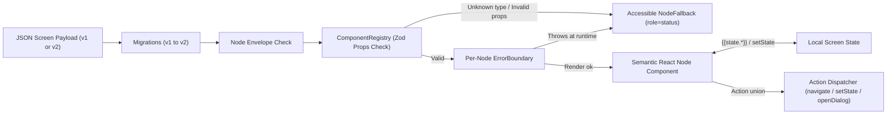

# sdui-lab

A typed, schema-validated server-driven UI (SDUI) runtime for React 18, paired with an interactive Playground and an honest measurement of what the abstraction costs compared to hand-written React.

## The Problem

Server-driven UI lets a backend describe screens as JSON so copy, layouts, and flows can ship without redeploying client binaries. In practice, naive SDUI implementations break in predictable ways:

1. **Schema drift:** TypeScript types and runtime validation fall out of sync, letting invalid server payloads crash components.
2. **Blast radius:** One bad node or version mismatch crashes the entire screen.
3. **Unsafe dynamism:** Template strings or action handlers evaluated with `eval` / `new Function` open XSS holes.
4. **Silent versioning debt:** Old JSON payloads break silently when prop names evolve.
5. **Unmeasured overhead:** Teams adopt SDUI without quantifying the bundle size and per-render cost they pay in exchange.

`sdui-lab` addresses each of these explicitly, using a minimal codebase you can read end-to-end.

---

## How It Works

1. **Schema & Types (`src/schema/`):** Every document (`v1` or `v2`), node (`Stack`, `Text`, `Button`, `Image`, `Card`, `List`, `Input`, `Conditional`), and action (`navigate`, `setState`, `openDialog`) is defined once in Zod. TypeScript types are inferred from those schemas.
2. **Version Migrations (`src/migrations/`):** If an incoming payload declares `version: 1`, pure migration functions transform legacy v1 props into the v2 contract before components render.
3. **Component Registry (`src/runtime/registry.ts`):** Maps node `type` names to React components paired with their Zod props schema. Registering a component enforces compile-time alignment between the schema and React props, and validates props at runtime before rendering.
4. **Per-Node Isolation (`src/runtime/renderer.tsx`, `src/runtime/ErrorBoundary.tsx`):** Each node is validated individually and wrapped in its own React `ErrorBoundary`. An unknown node type, invalid prop, or runtime render exception renders a small accessible fallback (`role="status"`) showing the exact JSON path, leaving sibling nodes interactive.
5. **Safe Bindings & Actions (`src/runtime/binding.ts`, `src/runtime/actions.ts`):** A small hand-written tokenizer resolves `{{state.key}}` placeholders strictly against local screen state via `Object.hasOwn`. Buttons dispatch a closed discriminated union of declarative actions (`navigate`, `setState`, `openDialog`)—no `eval`, no `new Function`, no `dangerouslySetInnerHTML`.

---

## Architecture



### Directory Layout

- `src/schema/` — Zod schemas (`v1.ts`, `v2.ts`, `actions.ts`), version constants, inferred types, JSON-path error formatter (`errors.ts`)
- `src/migrations/` — Explicit `v1 -> v2` migration functions (`v1ToV2.ts`, `migrate.ts`) + tests
- `src/runtime/` — `ComponentRegistry`, `SduiRenderer`, `NodeErrorBoundary`, `NodeFallback`, binding parser (`binding.ts`), action dispatcher (`actions.ts`)
- `src/components/` — Accessible implementations of all 8 node types + `createDefaultRegistry()`
- `src/playground/` — Split-pane JSON editor, debounced inline validation panel, 5 examples (including v1 migration & "break it on purpose")
- `src/tradeoffs/` — Side-by-side Hand-Written React vs. SDUI screen, `<React.Profiler>` telemetry, `flushSync` micro-benchmark, and CLI measurement baseline
- `docs/adr/` — Architecture Decision Records (`001`–`004`)

---

## Schema Versioning & Breaking Change (`v1` -> `v2`)

Supporting old clients or cached documents requires explicit boundary migrations instead of scattering `props.content ?? props.value` across components.

Breaking changes between `v1` and `v2` handled by `migrateV1ToV2` (`src/migrations/v1ToV2.ts`):

| Node     | `v1` Contract                                        | `v2` Contract                                                                              | Why Changed                                                     |
| -------- | ---------------------------------------------------- | ------------------------------------------------------------------------------------------ | --------------------------------------------------------------- |
| `Stack`  | `props.orientation`: `'vertical' \| 'horizontal'`    | `props.direction`: `'column' \| 'row'`                                                     | Aligns layout terminology with CSS Flexbox                      |
| `Text`   | `props.value` + `props.size`: `'sm' \| 'md' \| 'lg'` | `props.content` + `props.variant`: `'h1' \| 'h2' \| 'h3' \| 'body' \| 'caption' \| 'code'` | Decouples visual scale from semantic heading hierarchy          |
| `Button` | `props.navigateTo`: `string`                         | `props.action`: `{ type: 'navigate' \| 'setState' \| 'openDialog', ... }`                  | Unifies all button side effects into one validated action union |

`SduiRenderer` also runs `migrateRawV1BestEffort` so a v1 document containing a single malformed node still migrates valid siblings and isolates only the broken node.

---

## Security Reasoning & Design Decisions

See [`docs/adr/`](docs/adr/) for the four Architecture Decision Records:

- [ADR 001: Zod as Single Source of Truth](docs/adr/001-zod-single-source-of-truth.md)
- [ADR 002: Per-Node Error Boundaries](docs/adr/002-per-node-error-boundaries.md)
- [ADR 003: Declarative Actions & Bindings Without `eval`](docs/adr/003-declarative-actions-and-bindings-without-eval.md)
- [ADR 004: Explicit Versioned Migrations](docs/adr/004-explicit-versioned-migrations.md)

Key security invariants enforced in tests:

- **No `eval`, `new Function`, or `dangerouslySetInnerHTML`** anywhere in the codebase.
- **Prototype pollution & global escape protection:** `resolveBindings` rejects non-`state.*` roots (`{{window.location}}`, `{{alert(1)}}`), rejects `__proto__`, `constructor`, and `prototype` segments, and checks ownership with `Object.hasOwn` so `{{state.toString}}` resolves to `[unknown: state.toString]`.
- **Safe image URLs:** `ImagePropsSchema` validates `src` with `isSafeImageUrl`, allowing only `http:`, `https:`, or root-relative `/` paths (`javascript:`, `vbscript:`, and `data:text/html` are rejected).

---

## Dependencies

Runtime dependencies are intentionally minimal:

| Package              | Purpose                                                | Justification                                                              |
| -------------------- | ------------------------------------------------------ | -------------------------------------------------------------------------- |
| `react`, `react-dom` | UI rendering (`^18.3.1`)                               | Required runtime target                                                    |
| `zod`                | Runtime schema validation & type inference (`^3.23.8`) | Single source of truth for schemas, JSON-path errors, and TypeScript types |

No CSS-in-JS runtime, no UI component library, no router library, and no expression-evaluation library are used. Styling uses plain CSS with custom properties (`src/styles/tokens.css`), automatically adapting to light and dark mode via `@media (prefers-color-scheme: dark)`.

---

## Measured Trade-Offs ("What Does the Abstraction Cost?")

The **Trade-offs** tab compares one realistic interactive screen ("Workspace Profile": headings, card, two controlled inputs, conditional toggle buttons, and an ordered list) built two ways:

1. **Hand-Written React** (`src/tradeoffs/HandwrittenScreen.tsx`)
2. **SDUI Runtime** (`SduiRenderer` + `createDefaultRegistry()` + `BENCHMARK_SCREEN_DOC`)

Both share identical CSS classes and semantic HTML so differences reflect runtime abstraction overhead alone.

### Measurement Method

Run the reproducible benchmark script yourself:

```bash
pnpm measure:tradeoffs
```

`scripts/measure-tradeoffs.mjs` measures:

1. **Isolated bundle contribution:** Uses Vite/Rollup in production mode (`minify: 'esbuild'`, `react` and `react-dom` externalized) to bundle each target independently and compares raw minified and `zlib.gzipSync` byte sizes.
2. **Render time & commit counts:** Mounts each screen and runs 50 synchronous `flushSync` updates (after 3 warmup mount/unmount cycles) inside `<React.Profiler>` under `jsdom` with React development mode enabled (`Node v22.23.5`, `win32/x64`).

### Measured Results (`2026-11-27`)

| Metric                        | Hand-Written React        | SDUI Runtime + Zod + Registry | Measured Overhead          |
| ----------------------------- | ------------------------- | ----------------------------- | -------------------------- |
| Isolated JS bundle (minified) | `3.89 kB` (`3,983 B`)     | `103.60 kB` (`106,085 B`)     | `+99.71 kB` (`+102,102 B`) |
| Isolated JS bundle (gzip)     | `1.09 kB` (`1,112 B`)     | `21.93 kB` (`22,455 B`)       | `+20.84 kB` (`+21,343 B`)  |
| Mount commits / duration      | `1` commit · `3.927 ms`   | `1` commit · `4.830 ms`       | `+0.903 ms`                |
| 50-update commits / median    | `50` commits · `0.161 ms` | `50` commits · `0.604 ms`     | `3.75x` slower per update  |

Production Vite build chunks for the full demo app (`pnpm build`):

- `react` chunk: `141.67 kB` (`45.47 kB` gzip)
- `zod` chunk: `55.75 kB` (`12.80 kB` gzip)
- App + Playground + Trade-offs (`index` chunk): `43.99 kB` (`13.21 kB` gzip)
- Stylesheet (`index` CSS): `16.61 kB` (`3.18 kB` gzip)

**Honest caveats:**

- React strips `<Profiler>` `onRender` callbacks in standard production builds (`react-dom`), so the `React.Profiler` timings above were recorded under React development mode in `jsdom`—useful for relative overhead (`~3.75x` per-update cost due to per-node Zod validation, tree traversal, binding tokenization, and error boundaries), not absolute production browser latency.
- Inside the live browser **Trade-offs** tab, the **"Run 50-update browser benchmark"** button uses `performance.now()` around `flushSync` so you get real timing numbers in production builds too, alongside `<Profiler>` commit counts when running in `pnpm dev`.

---

## When SDUI Is Worth It (and When It Isn't)

**SDUI is worth the cost when:**

- **Release velocity matters more than bundle size:** Native mobile apps or locked-down client environments with slow store review cycles need server-controlled copy, ordering, and experiments without shipping a new binary.
- **Cross-platform consistency:** One backend payload drives web, iOS, and Android from a shared finite catalog of design-system primitives.
- **Backend-owned eligibility:** Server business rules already determine which cards, banners, or steps a user sees.

**SDUI is usually _not_ worth it when:**

- **Fast web CI/CD:** Standard web React apps already deploy in minutes; adding an SDUI runtime trades ~21 kB gzipped and ~3–4x per-render overhead for release flexibility you already have.
- **Debugging indirection:** Stack traces point to generic renderer loops rather than feature components, and inspecting state/props requires runtime tooling.
- **Type safety ceiling:** TypeScript guarantees the _renderer_ is type-safe against your schema, not that a remote CMS or backend service didn't push an outdated payload.
- **Versioning burden:** Every breaking component change requires maintaining explicit migrations (`v1 -> v2 -> v3`) until old clients or cached documents expire.
- **Complex client interactivity:** Rich editors, drag-and-drop, canvas tools, or intricate cross-field form validation quickly outgrow declarative JSON schemas.

---

## Limitations

- **Flat/primitive local state:** `StateMap` supports `string | number | boolean | null`; nested arrays/objects and computed derived state are intentionally excluded.
- **No memoized node caching yet:** On every state change, `SduiRenderer` re-validates visible nodes in the tree rather than caching Zod parse results by node identity/reference.
- **No dynamic list templating (`each`):** `List` renders explicit `items` arrays rather than iterating over dynamic state arrays.
- **No server endpoint:** Screens are loaded client-side in the Playground rather than fetched from a live API.

---

## Running Locally

Prerequisites: Node.js 20+ and `pnpm` 9+.

```bash
pnpm install
pnpm dev              # Start local dev server (http://localhost:5173)
pnpm lint             # ESLint (typescript-eslint strict + react-hooks + jsx-a11y)
pnpm typecheck        # tsc --noEmit (strict + noUncheckedIndexedAccess)
pnpm test             # Vitest + React Testing Library + jest-axe
pnpm test:coverage    # Unit test coverage report
pnpm build            # Typecheck + production Vite build
pnpm measure:tradeoffs # Reproduce bundle & React Profiler overhead numbers
```

To run Playwright E2E tests:

```bash
pnpm exec playwright install chromium
pnpm test:e2e
```

---

## Adding a New Node Component

1. **Define the Zod props schema** in `src/schema/v2.ts` and add the variant to `NodePropsMap` and `SduiNodeSchema`:
   ```ts
   export const BadgePropsSchema = z.object({
     text: z.string().min(1),
     tone: z.enum(['neutral', 'success', 'danger']).optional(),
   });
   export type BadgeProps = z.infer<typeof BadgePropsSchema>;
   ```
2. **Create the React component** in `src/components/BadgeNode.tsx` using `SduiComponentProps<BadgeProps>`:
   ```tsx
   export function BadgeNode({ props, context }: SduiComponentProps<BadgeProps>) {
     return (
       <span className={`sdui-badge sdui-badge--${props.tone ?? 'neutral'}`}>
         {context.resolveText(props.text)}
       </span>
     );
   }
   ```
3. **Register it** in `src/components/defaultRegistry.ts`:
   ```ts
   registry.register({ type: 'Badge', schema: BadgePropsSchema, component: BadgeNode });
   ```
4. **Add unit + `jest-axe` tests** verifying schema validation, binding resolution, and accessibility.

---

## What I Would Do Next

- **Memoize Zod validation per node reference** (or structural hash) in `SduiRenderer` so state updates like typing in an `Input` skip re-validating static sibling subtrees—cutting the measured `3.75x` update overhead down significantly.
- **JSON Schema export (`zod-to-json-schema`)** so backend services in Go/Python/Java can validate payloads against the exact same contract at publish time.
- **Telemetry hook for production fallbacks** to report `unknown_type` and `invalid_props` occurrences by `screenId` and `path`.
- **Keyboard-accessible JSON editor enhancements** (line numbers, schema autocomplete) while preserving screen-reader usability.
